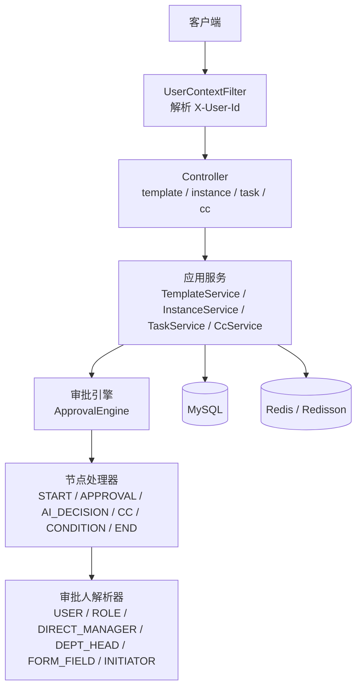
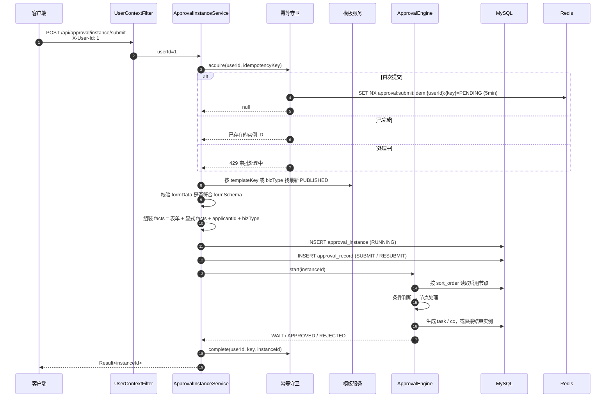
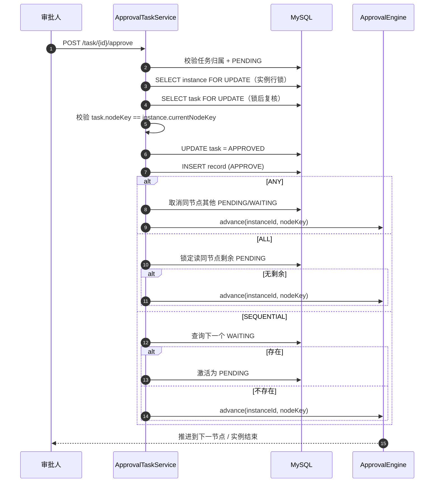
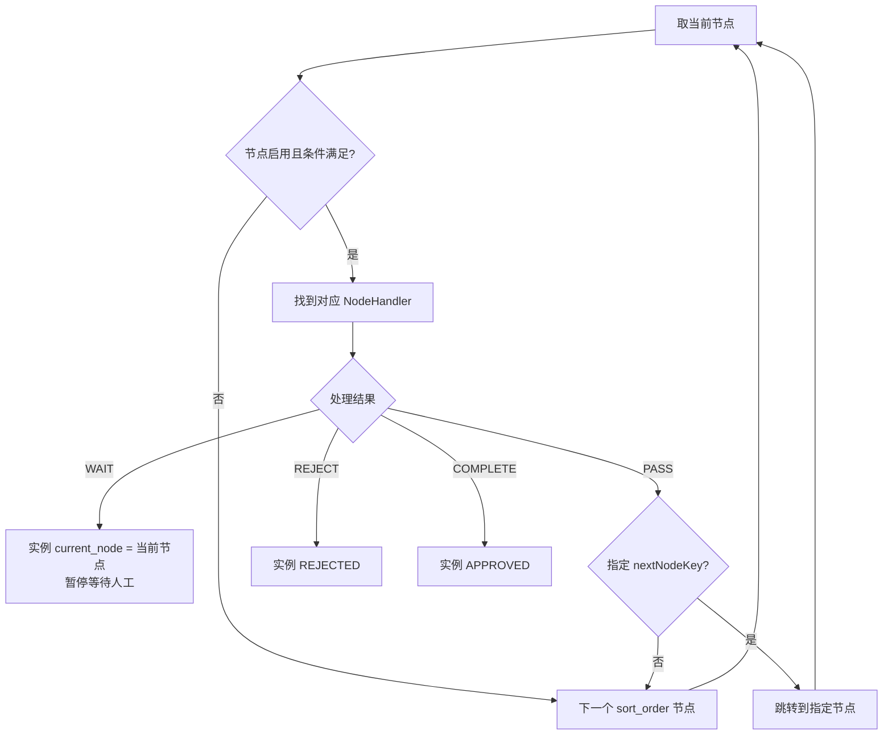
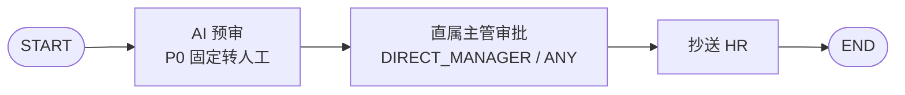
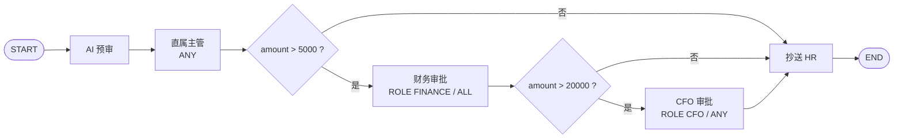
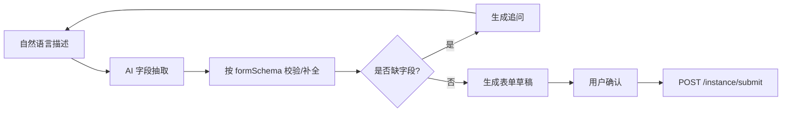

# 通用审批平台业务链路说明

> 适用代码：`main` 分支（2026-10-26）
> 文档范围：当前已实现的审批平台能力（模板配置、提交、审批、抄送、撤回、重新提交、幂等与单号）
> 不在本文范围：AI 填表 / AI 决策插件的具体模型调用实现（仅说明接入位置与安全边界）
> 配套文档：[需求文档.md](./需求文档.md)（需求基线）、[接口文档.md](./接口文档.md)（完整接口契约）

---

## 1. 平台定位

`vllmpt` 本身是一个面向企业知识场景的 AI Agent 后端平台，通用审批平台是其中一个业务模块：

```
src/main/java/org/albedo/vllmpt/module/approval
└── core
    ├── controller        HTTP 接口
    ├── service           应用服务（实例、任务、抄送、模板）
    ├── engine            流程引擎（节点推进、条件判断、审批人解析）
    ├── domain            实体、枚举、DTO、领域模型
    └── mapper            MyBatis-Plus Mapper
```

设计原则：

1. **引擎不感知具体业务**：请假、差旅费、采购、用印等业务共用同一套引擎，差异全部由模板配置表达。
2. **模板驱动流程**：节点顺序、审批人、审批模式、条件分支、抄送、AI 决策全部落在 `approval_template_node`。
3. **实例绑定模板版本**：实例创建时固定 `template_id + template_version`，后续模板升级或下线不影响运行中的实例。
4. **AI 只做增强，不做唯一决策源**：AI 不可用、低置信度、高风险时必须转人工。

---

## 2. 分层与请求入口



开发期身份：

- 请求头 `X-User-Id` 指定当前用户；
- `application-dev.yml` 中 `app.identity.default-user-enabled=true` 时，不传请求头默认用户 `1`；
- 生产环境应关闭默认用户，并接入真实登录态。

演示数据用户：

| 用户 ID | 姓名 | 角色 |
|---|---|---|
| 1 | 演示员工 | 申请人 |
| 2 | 张主管 | 直属主管 / MANAGER |
| 3 | 李财务 | FINANCE |
| 4 | 王 HR | HR |
| 5 | 赵总 | CFO |

---

## 3. 领域模型

### 3.1 核心表

| 表 | 作用 | 关键约束 |
|---|---|---|
| `approval_template` | 模板主表，同一 `template_key` 多版本 | `uk_template_key_version(template_key, version)` |
| `approval_template_node` | 模板节点，定义流程 | `uk_template_node(template_id, node_key)` |
| `approval_instance` | 审批实例，一次申请一条 | `uk_instance_no(instance_no)` |
| `approval_task` | 人工审批任务 | `uk_task_key(instance_id, node_key, assignee_id, sequence_no)` |
| `approval_record` | 审批流水，审计用 | 无唯一键，按实例追加 |
| `approval_cc` | 抄送记录 | `uk_instance_node_receiver(instance_id, node_key, receiver_id)` |
| `leave_request` | 请假业务表（P1） | `uk_leave_instance(approval_instance_id)` |
| `leave_balance` | 年假/调休余额（P1） | `uk_user_type_year(user_id, leave_type, year)` |
| `sys_holiday` | 节假日/调休工作日（P1） | `uk_holiday_date(holiday_date)` |
| `sys_department` | 部门与负责人 | `uk_dept_code` |
| `sys_user_profile` | 员工档案：部门、直属主管 | 主键 `user_id` |
| `sys_user_role` | 用户角色 | `uk_user_role(user_id, role_code)` |

### 3.2 实例状态

`approval_instance.status`：

| 状态 | 含义 |
|---|---|
| `RUNNING` | 运行中，等待人工审批或自动推进 |
| `APPROVED` | 流程正常结束 |
| `REJECTED` | 任一节点拒绝 |
| `CANCELED` | 申请人撤回 |
| `TERMINATED` | 预留：管理员终止 |

> `DRAFT` 在枚举中保留，但当前提交接口直接创建 `RUNNING` 实例。

### 3.3 任务状态

`approval_task.status`：

| 状态 | 含义 |
|---|---|
| `WAITING` | 顺序审批中尚未轮到 |
| `PENDING` | 当前可处理 |
| `APPROVED` / `REJECTED` | 已同意 / 已拒绝 |
| `SKIPPED` | 预留 |
| `TRANSFERRED` | 预留：转办 |
| `CANCELED` | 或签他人已处理、实例结束或撤回 |

### 3.4 节点类型

| 类型 | 行为 |
|---|---|
| `START` | 流程入口，直接通过 |
| `APPROVAL` | 解析审批人并生成任务，等待人工处理 |
| `AI_DECISION` | AI 决策；P0 未接入插件时**固定转人工** |
| `CC` | 写入抄送记录后立即继续，不阻塞 |
| `CONDITION` | 条件节点，条件不满足则跳过（引擎对任意节点都支持条件跳过） |
| `END` | 流程结束，实例置为 `APPROVED` |

### 3.5 审批人类型

| 类型 | 配置示例 | 解析来源 |
|---|---|---|
| `USER` | `{"userIds":[2,3]}` | 指定用户 |
| `ROLE` | `{"roleCode":"FINANCE"}` | `sys_user_role` |
| `DIRECT_MANAGER` | 无 | `sys_user_profile.manager_id` |
| `DEPT_HEAD` | 无 | `sys_department.leader_id` |
| `FORM_FIELD` | `{"field":"approverId"}` | 表单/事实字段中的用户 ID |
| `INITIATOR` | 无 | 实例申请人 |

> 若解析出的审批人全部等于申请人，节点会自动跳过并写入 `SKIP` 流水，避免自审。

### 3.6 审批模式

| 模式 | 任务初始化 | 推进条件 |
|---|---|---|
| `ANY`（或签） | 全部 `PENDING` | 任意一人通过，其余任务 `CANCELED` |
| `ALL`（会签） | 全部 `PENDING` | 全部通过才推进；任一人拒绝则实例 `REJECTED` |
| `SEQUENTIAL`（顺序） | 首个 `PENDING`，其余 `WAITING` | 前一个通过后激活下一个 |

---

## 4. 模板配置链路

```mermaid
flowchart LR
    C[创建模板<br/>POST /template] --> D[DRAFT]
    D --> U[编辑草稿<br/>PUT /template/{id}]
    U --> D
    D --> P[发布<br/>POST /template/{id}/publish]
    P --> PUB[PUBLISHED]
    PUB --> DIS[下线<br/>POST /template/{id}/disable]
    DIS --> X[DISABLED]
    P --> N[同一 templateKey 创建新版本]
    N --> D
```

规则：

1. **创建**：同一 `template_key` 已有 `DRAFT` 时禁止再建，必须先发布或处理掉草稿。
2. **编辑**：只允许 `DRAFT`；节点按请求**全量替换**（先物理删除旧节点，再插入新节点）。
3. **发布**：校验必须且只能有一个 `START`、至少一个 `END`；审批节点必须有 `assigneeType`，`ROLE/USER/FORM_FIELD` 必须有配置；CC 配置必须能解析。
4. **版本**：同一个 `template_key` 每次新建版本号递增；已发布版本内容不再修改。
5. **下线**：只允许 `PUBLISHED → DISABLED`；运行中的实例仍绑定原 `template_id`，不受影响。
6. **运行中实例**：始终按创建时的 `template_id` 读取节点，不会读取到新版本。

### 4.1 表单 Schema

`approval_template.form_schema` 是字段定义 JSON，供前端动态渲染和 AI 填表使用：

```json
{
  "fields": [
    {"name": "leaveType", "label": "请假类型", "type": "STRING", "required": true},
    {"name": "startTime", "label": "开始时间", "type": "STRING", "required": true},
    {"name": "endTime", "label": "结束时间", "type": "STRING", "required": true},
    {"name": "reason", "label": "请假事由", "type": "STRING", "required": true},
    {"name": "attachmentUrls", "label": "证明材料", "type": "ARRAY", "required": false}
  ]
}
```

查询最新已发布模板的表单：

```http
GET /api/approval/template/schema/LEAVE
```

> 当前接口返回 `Result<String>`，`data` 是 JSON 字符串，客户端需要二次解析。

### 4.2 条件 DSL

节点 `condition_json` 为真才执行该节点，否则直接跳到下一个节点：

```json
{"field":"amount","op":"GT","value":5000}
```

组合条件：

```json
{
  "op": "AND",
  "children": [
    {"field": "amount", "op": "GT", "value": 5000},
    {"field": "city", "op": "IN", "value": ["上海", "北京"]}
  ]
}
```

支持运算符：

| 类别 | 运算符 |
|---|---|
| 逻辑 | `AND` / `OR` / `NOT` |
| 比较 | `EQ` / `NE` / `GT` / `GTE` / `LT` / `LTE` |
| 集合 | `IN` / `NOT_IN` / `CONTAINS` / `EXISTS` |

实现使用 JSON 求值，不使用 SpEL，避免表达式注入。

---

## 5. 端到端主链路

### 5.1 提交审批



提交时的关键处理：

1. `templateKey` 优先；为空时用 `bizType` 找最新已发布模板。
2. `formData` 必须是 JSON 对象，并按模板 `form_schema` 校验必填项与类型。
3. `facts` 是流程判断使用的扁平事实集：表单字段自动进入，`facts` 显式覆盖，最后补 `applicantId`、`bizType`。
4. 实例号由 `ApprovalNumberGenerator` 生成。
5. 提交、流水、流程启动在同一事务内完成。
6. **业务插件（P1）**：若 `bizType` 已注册 `ApprovalBizHandler`，按以下顺序执行（同一事务）：
   - `validate`：业务规则校验（请假为时间/工作日/余额/冲突/证明材料）；
   - `createBizRecord`：写业务表并锁定资源（如假期余额）；
   - `bindInstance`：回填 `approval_instance_id`；
   - `extractFacts`：合并业务事实（如 `leaveDays`、`balanceAvailable`），供条件节点使用；
   - 引擎结束后 `applyResult`：通过则结算资源，拒绝/撤回则释放；失败回滚整个审批事务。

### 5.2 我的待办

```http
GET /api/approval/task/todo?limit=50
X-User-Id: 2
```

仅返回：

- `assignee_id = 当前用户`
- `approval_task.status = PENDING`
- 所属实例 `status = RUNNING`

任务详情 `GET /api/approval/task/{id}` 只允许任务审批人查看，返回任务、实例、表单 Schema 和完整流水。

### 5.3 同意 / 拒绝



拒绝：

1. 任务置为 `REJECTED`，写 `REJECT` 流水；
2. 同节点其他待办全部 `CANCELED`；
3. `ApprovalEngine.reject` 将实例置为 `REJECTED`，结束时间写入 `finished_at`。

并发控制：

- 实例行 `SELECT ... FOR UPDATE` 串行化同一实例的审批动作；
- 实例 `version` 乐观锁兜底；
- `task_key` 唯一键防止同一节点重复生成同一审批人的任务。

### 5.4 引擎推进规则



补充：

- 节点按 `sort_order` 升序线性推进，`sort_order` 相同再按 `id`。
- 条件不满足的节点直接跳过，不写任务。
- AI 决策节点可通过 `ai_on_approve_node_key` / `ai_on_escalate_node_key` 显式跳转。
- 引擎用 `visited` 集合检测环，出现回环会抛 500。
- 流程结束会取消所有未完成任务。

### 5.5 抄送链路

```mermaid
flowchart LR
    A[CC 节点] --> B[解析 cc_config]
    B --> C[按 USER/ROLE/DIRECT_MANAGER/... 解析接收人]
    C --> D[INSERT IGNORE approval_cc]
    D --> E[继续下一节点]
    E --> F[被抄送人 GET /api/approval/cc/my]
    F --> G[POST /api/approval/cc/{id}/read]
```

规则：

1. 抄送不生成 `approval_task`，不阻塞流程。
2. `approval_cc` 有 `(instance_id, node_key, receiver_id)` 唯一键，重复进入节点不会重复抄送。
3. 渠道字段当前固定 `INBOX`，后续可扩展 `DINGTALK`、`FEISHU`、`EMAIL`。
4. 被抄送人可以查看实例详情（`assertVisible` 会检查 `approval_cc`）。

抄送配置示例：

```json
[
  {"type": "ROLE", "roleCode": "HR"},
  {"type": "USER", "userIds": [2, 3]}
]
```

### 5.6 撤回

```http
POST /api/approval/instance/{id}/cancel
X-User-Id: 1
```

规则：

- 只有申请人可以撤回；
- 只有 `RUNNING` 实例可以撤回；
- 实例置 `CANCELED`，所有 `PENDING/WAITING` 任务置 `CANCELED`；
- 写 `WITHDRAW` 流水，记录撤回原因；
- 使用 `version` 乐观锁，状态已变化时返回 409。

### 5.7 驳回后重新提交

```http
POST /api/approval/instance/{id}/resubmit
X-User-Id: 1

{
  "formData": { "...": "可选，修改后的表单" },
  "facts": { "...": "可选" },
  "title": "可选",
  "idempotencyKey": "可选"
}
```

规则：

1. 只有申请人可以重新提交；
2. 父实例必须是 `REJECTED`；
3. 沿用父实例的 `template_id` 与版本，**不会**自动切到新版本；
4. 创建新实例，`parent_instance_id` 指向旧实例，`submit_count = 父实例.submit_count + 1`；
5. 表单为空时沿用父实例表单快照，仍会重新执行 Schema 校验；
6. 写 `RESUBMIT` 流水，备注原实例号；
7. 模板已 `DISABLED` 时禁止重新提交。

### 5.8 幂等与单号

**提交幂等**

- 请求体字段：`idempotencyKey`（客户端生成，建议 UUID）。
- Redis key：`approval:submit:idem:{userId}:{idempotencyKey}`，TTL 5 分钟。
- 首次：写入 `PENDING`；
- 重复且已完成：直接返回首次创建的实例 ID；
- 重复且处理中：返回 429；
- Redis 不可用：跳过幂等校验并打 WARN，主链路继续；
- 事务回滚：通过 `TransactionSynchronization` 释放占位。

**实例单号**

- 格式：`AP + yyyyMMdd + 6 位序号`，例如 `AP20261022000001`。
- 序号在 Redis 中按日期**全局递增**，不区分业务类型，保证 `instance_no` 全局唯一。
- key：`approval:no:{yyyyMMdd}`，TTL 2 天。
- Redis 不可用时降级为日期 + 6 位随机数，冲突由 `uk_instance_no` 兜底。

> 本次检查修复了一个缺陷：原实现按 `bizType + date` 分别计数，但单号格式不含业务类型，导致请假与差旅费在同一天都会生成 `...000001`，第二个业务提交会撞唯一键。现已改为全局按日期计数。

---

## 6. 演示模板链路

### 6.1 请假 `leave`



- AI 节点配置了 `ai_on_escalate_node_key=manager_approval`，P0 一律转人工。
- user1 提交 → user2 待办 → user2 同意 → 抄送 user4 → 实例 `APPROVED`。

### 6.2 差旅费 `travel_expense`



金额分支结果：

| 金额 | 实际节点 |
|---|---|
| 3000 | 主管 → 抄送 HR |
| 8000 | 主管 → 财务 → 抄送 HR |
| 30000 | 主管 → 财务 → CFO → 抄送 HR |

---

## 7. 接口清单

> 下表为链路视角的速查；完整的请求/响应字段、错误码与示例见 [接口文档.md](./接口文档.md) 第 3 章。

### 7.1 模板

| 方法 | 路径 | 说明 |
|---|---|---|
| POST | `/api/approval/template` | 创建草稿模板 |
| PUT | `/api/approval/template/{id}` | 编辑草稿（节点全量替换） |
| POST | `/api/approval/template/{id}/publish` | 发布草稿 |
| POST | `/api/approval/template/{id}/disable` | 下线已发布模板 |
| GET | `/api/approval/template/{id}` | 模板详情（含节点） |
| GET | `/api/approval/template/list?bizType=` | 模板列表 |
| GET | `/api/approval/template/schema/{bizType}` | 最新已发布模板的表单 Schema |

### 7.2 实例

| 方法 | 路径 | 说明 |
|---|---|---|
| POST | `/api/approval/instance/submit` | 提交审批 |
| GET | `/api/approval/instance/{id}` | 实例详情（实例 + 任务 + 流水 + 抄送） |
| GET | `/api/approval/instance/my?status=&limit=` | 我的申请 |
| POST | `/api/approval/instance/{id}/cancel` | 撤回 |
| POST | `/api/approval/instance/{id}/resubmit` | 驳回后重新提交 |

### 7.3 任务

| 方法 | 路径 | 说明 |
|---|---|---|
| GET | `/api/approval/task/todo?limit=` | 我的待办 |
| GET | `/api/approval/task/{id}` | 任务详情 |
| POST | `/api/approval/task/{id}/approve` | 同意 |
| POST | `/api/approval/task/{id}/reject` | 拒绝 |

### 7.4 抄送

| 方法 | 路径 | 说明 |
|---|---|---|
| GET | `/api/approval/cc/my?limit=` | 抄送我的 |
| POST | `/api/approval/cc/{id}/read` | 标记已读 |

### 7.5 草稿（P1）

| 方法 | 路径 | 说明 |
|---|---|---|
| POST | `/api/approval/draft` | 保存/合并草稿（含 missingFields） |
| GET | `/api/approval/draft/current?bizType=&sessionId=` | 当前草稿 |
| DELETE | `/api/approval/draft?bizType=&sessionId=` | 删除草稿 |

### 7.6 请假业务（P1）

| 方法 | 路径 | 说明 |
|---|---|---|
| POST | `/api/leave/request` | 提交请假（内部走通用提交 + 请假插件） |
| GET | `/api/leave/request/{instanceId}` | 请假详情（审批 + 业务数据） |
| GET | `/api/leave/request/my?status=&limit=` | 我的请假 |
| POST | `/api/leave/request/{instanceId}/cancel` | 撤回并释放余额 |
| GET | `/api/leave/balance` | 当年假期余额 |

---

## 8. 权限与可见性

| 操作 | 规则 |
|---|---|
| 查看实例 | 申请人 / 该实例任务审批人 / 该实例抄送接收人 |
| 查看任务 | 只能查看分配给自己的任务 |
| 同意 / 拒绝 | 只能处理分配给自己的 `PENDING` 任务 |
| 撤回 | 只有申请人，且实例 `RUNNING` |
| 重新提交 | 只有申请人，且父实例 `REJECTED` |
| 标记抄送已读 | 只能操作发给自己的抄送 |
| 编辑模板 | 只有 `DRAFT` 状态，接口本身未做角色校验 |

> 当前安全配置对所有路径 `permitAll`，身份完全依赖 `X-User-Id`。接入真实登录态前，不应直接暴露到公网。

---

## 9. 事务与一致性

| 操作 | 事务边界 |
|---|---|
| 提交 | 业务记录/余额锁定 + 实例 + 流水 + 引擎启动（任务/抄送/当前节点） |
| 同意/拒绝 | 任务状态 + 流水 + 引擎推进 + 业务结果回调（余额结算/释放） |
| 撤回 | 实例状态 + 任务取消 + 流水 + 业务结果回调 |
| 重新提交 | 新业务记录 + 新实例 + 新流水 + 引擎启动 |

一致性手段：

- 实例级 `SELECT ... FOR UPDATE`，避免同一实例并发审批；
- 实例 `version` 乐观锁，更新失败返回 409；
- 会签剩余任务使用锁定读，避免 REPEATABLE READ 旧快照；
- `task_key` 唯一键保证任务幂等；
- `approval_cc` 唯一键保证抄送幂等；
- 假期余额使用条件更新（`locked_days >= days`、可用额度校验），并发提交不会超卖；
- Redis 只做加速与幂等，不参与最终状态判定。

---

## 10. AI 能力接入位置

### 10.1 AI 填表（P2 已实现）

对话入口：`/api/pipline/fack` 或 `/api/pipline/stream`，请求体传 `bizType`（如 `LEAVE`）。服务端会自动：

1. 用 `ApprovalPromptBuilder` 生成审批提示词（含模板 `form_schema`）；
2. 只暴露 `approval` 工具组（`ApprovalToolProvider`）；
3. 跳过知识库检索；
4. 通过 `ToolContext` 注入 `userId / sessionId / bizType`，工具方法不接受模型传这些参数。

工具：

| 工具 | 参数 | 行为 |
|---|---|---|
| `saveApprovalDraft` | `formJson` | 合并草稿，返回 `missingFields` 与当前表单 |
| `submitApprovalDraft` | 无 | 提交草稿，返回实例 ID / 单号 / 当前节点 |
| `queryMyApprovals` | `status`（可选） | 查询本人该业务类型的审批记录 |
| `cancelApproval` | `instanceId` | 撤回本人运行中的审批 |

当前已具备的基础：

- 模板 `form_schema` 定义字段；
- `GET /api/approval/template/schema/{bizType}` 提供最新 Schema；
- 草稿接口（`/api/approval/draft`）支持多轮合并与 `missingFields` 计算；
- 提交接口接收结构化 `formData`。

实现链路：



草稿与业务事实已由 P1/P2 提供：`/api/approval/draft` 负责多轮合并与缺失字段，`ApprovalBizHandler.extractFacts` 负责业务事实，`ApprovalToolProvider` 负责模型工具调用。

### 10.2 AI 智能决策（规划中的 P3）

`AI_DECISION` 节点字段：

| 字段 | 含义 |
|---|---|
| `ai_policy_key` | 决策策略标识 |
| `ai_min_confidence` | 自动通过最低置信度 |
| `ai_on_approve_node_key` | AI 通过后跳转节点 |
| `ai_on_escalate_node_key` | AI 转人工节点 |
| `ai_on_reject_action` | `REJECT` / `NEXT_NODE` |

P0 安全策略：

- AI 决策插件未接入时，`AiDecisionNodeHandler` **一律转人工**；
- 即使接入，AI 失败、超时、低置信度、命中高风险规则都必须转人工；
- AI **不能**成为唯一自动通过来源。

---

## 11. 本次检查结论

### 11.1 已验证

| 项目 | 结果 |
|---|---|
| `mvnw -DskipTests compile` | 通过 |
| `ApprovalIdempotencyGuardTest` | 7/7 通过 |
| `ApprovalNumberGeneratorTest` | 3/3 通过 |
| `FormSchemaValidatorTest` | 4/4 通过 |
| `JsonConditionEvaluatorTest` | 6/6 通过 |
| `LeaveCalendarServiceTest`（P1） | 8/8 通过 |
| `LeaveBizHandlerTest`（P1） | 8/8 通过 |
| `ApprovalPromptBuilderTest`（P2） | 3/3 通过 |
| `ApprovalToolProviderTest`（P2） | 8/8 通过 |
| 代码变更范围 | P0：15 个文件；P1：SPI、请假插件、草稿、SQL 与单测；P2：AI 工具、提示词、工具上下文与单测 |
| 工作区 | P1/P2 变更未提交 |

### 11.2 已修复

| 严重度 | 问题 | 处理 |
|---|---|---|
| 高 | 单号按 `bizType + date` 分别计数，但格式不含业务类型，不同业务同日会生成重复单号，撞 `uk_instance_no` | 改为按日期全局计数，更新对应单测 |

### 11.3 待确认 / 建议

| 优先级 | 问题 | 建议 |
|---|---|---|
| P1 | 幂等键在事务提交前写入实例 ID，极端情况下并发请求可能拿到尚未提交的实例 ID | 改为 `afterCommit` 再写入实例 ID，事务中保持 `PENDING` |
| P1 | 下线当前最高版本后，仍为 `PUBLISHED` 的旧版本会自动重新生效 | 明确下线语义：按 `template_key` 下线全部版本，或禁止下线非最新版本 |
| P1 | 同一个已驳回实例可被多次重新提交，产生多个并行子实例 | 校验是否已有运行中的子实例，或在父实例上标记已重新提交 |
| P2 | `submit` 与 `resubmit` 共用幂等键命名空间 | 在 Redis key 中增加操作类型前缀 |
| P2 | `/template/schema/{bizType}` 返回 JSON 字符串而非对象 | 改为返回 `Map<String,Object>`，减少客户端二次解析 |
| P2 | 模板发布只校验 `assigneeConfig` 是否为合法 JSON，未校验配置结构 | 发布时调用解析器做结构校验（`ROLE` 必须有 `roleCode` 等） |
| P3 | Redis 降级随机单号冲突时没有重试 | 捕获唯一键冲突后重试生成，或改用数据库号段 |
| P3 | 抄送列表没有未读筛选 / 未读数接口 | 增加 `unreadOnly` 参数或统计接口 |

> 本次未启动 Docker 与 MySQL/Redis，因此未做运行时端到端回归；编译与新增单测已通过。运行回归步骤见下一节。

---

## 12. 运行与回归

### 12.1 启动依赖

```powershell
# 启动 MySQL / Redis 等容器（按项目实际 compose 文件）
docker compose -f .\doc\docker\docker-compose-env.yml up -d mysql redis chroma
```

### 12.2 导入 SQL

```powershell
# 审批核心表 + 演示模板
docker cp .\doc\sql\init_approval_platform.sql vllmpt-mysql:/tmp/init.sql
docker exec vllmpt-mysql sh -c "mysql --default-character-set=utf8mb4 -uroot -proot123 vllmpt_dev < /tmp/init.sql"

# P1 请假业务表 + 演示余额
docker cp .\doc\sql\init_leave_business.sql vllmpt-mysql:/tmp/init_leave.sql
docker exec vllmpt-mysql sh -c "mysql --default-character-set=utf8mb4 -uroot -proot123 vllmpt_dev < /tmp/init_leave.sql"
```

> 必须带 `--default-character-set=utf8mb4`，否则中文会双重编码成乱码。

### 12.3 启动应用

```powershell
.\mvnw.cmd spring-boot:run
```

### 12.4 冒烟调用

```powershell
# 提交请假（P1）
Invoke-RestMethod -Method Post `
  -Uri http://localhost:8080/api/leave/request `
  -Headers @{ "X-User-Id" = "1" } `
  -ContentType "application/json" `
  -Body '{"leaveType":"ANNUAL","startTime":"2026-10-27 09:00","endTime":"2026-10-28 18:00","reason":"回老家","idempotencyKey":"leave-001"}'

# 假期余额（提交后 lockedDays 应增加）
Invoke-RestMethod -Uri http://localhost:8080/api/leave/balance -Headers @{ "X-User-Id" = "1" }

# 主管待办
Invoke-RestMethod -Uri http://localhost:8080/api/approval/task/todo -Headers @{ "X-User-Id" = "2" }

# 同意（通过后 lockedDays → usedDays）
Invoke-RestMethod -Method Post `
  -Uri http://localhost:8080/api/approval/task/{taskId}/approve `
  -Headers @{ "X-User-Id" = "2" } `
  -ContentType "application/json" `
  -Body '{"comment":"同意"}'
```

### 12.5 单元测试

```powershell
.\mvnw.cmd "-Dtest=ApprovalIdempotencyGuardTest,ApprovalNumberGeneratorTest,FormSchemaValidatorTest,JsonConditionEvaluatorTest,LeaveCalendarServiceTest,LeaveBizHandlerTest" test
```

---

## 13. 关键 Redis Key

| Key | 类型 | TTL | 用途 |
|---|---|---|---|
| `approval:no:{yyyyMMdd}` | String 计数器 | 2 天 | 全局审批单号序号 |
| `approval:submit:idem:{userId}:{key}` | String | 5 分钟 | 提交幂等占位/实例 ID |
| `approval:draft:{userId}:{bizType}:{sessionId}` | String(JSON) | 30 分钟 | 填表草稿与缺失字段 |

---

## 14. 后续演进建议

1. **P1 业务插件**（已完成）：`ApprovalBizHandler` 把业务表单、事实抽取、业务校验从通用提交接口中解耦；请假为首个落地业务。
2. **P2 AI 填表**（已完成）：`bizType` 路由 + 审批提示词 + `approval` 工具组 + 草稿/提交/查询/撤回。
3. **P2 通知发件箱**：抄送落库后异步发送钉钉/飞书/邮件，失败可重试。
4. **P2 模板管理权限**：模板创建、发布、下线应限制管理员角色。
5. **P3 AI 决策**：接入 `ApprovalAiDecisionProvider`，保留强制转人工兜底。
6. **P3 审批超时**：基于 `sla_hours` 增加超时提醒、自动升级或转办。
